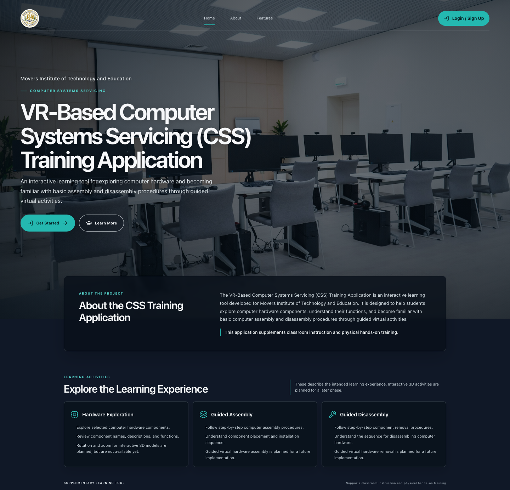
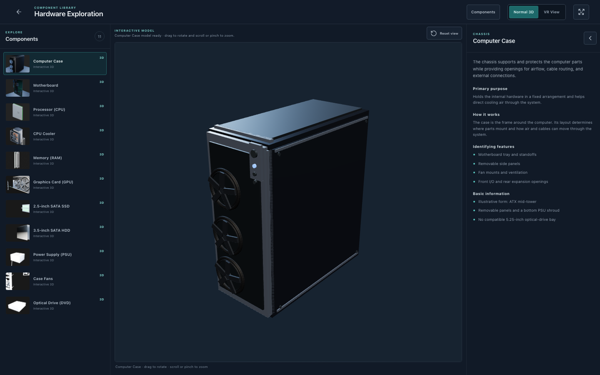
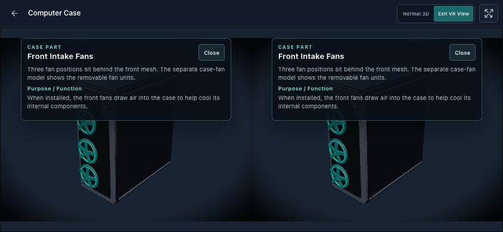

# VR-Based CSS Training Application

A mobile-first learning prototype for the research project **A VR-Based Computer Systems Servicing (CSS) Training Application with Interactive Hardware Learning for Movers Institute of Technology and Education (MITE)**. It supplements classroom instruction and physical hands-on practice.

The approved research scope and implementation boundaries are documented in [Project Context](docs/project-context.md), [System Flow](docs/system-flow.md), [Architecture](docs/architecture.md), and the [Chapter I requirement-to-prototype checklist](docs/requirement-traceability.md).

## Research objectives

The project addresses limited access to practice hardware, difficulty identifying computer components and their functions, limited individual practice opportunities, and difficulty following assembly and disassembly procedures. The current prototype demonstrates interactive hardware learning; it does not claim to complete the full future capstone system.

## Current prototype

- Student, CSS Instructor, and Principal role-based interface flows.
- Hardware Exploration with all 11 component GLBs, orbit, zoom, reset, and per-component educational details.
- Optional stationary side-by-side stereoscopic presentation. On phones, the learning workspace is landscape-only and pauses in portrait.
- In stereo mode, learners can tap confirmed named meshes on the Computer Case model to view part details and a restrained selection highlight.
- Responsive landing, profile, dashboard, and learning screens.
- Component 10, the optical drive, is presented as a standalone learning asset.







## Simulated and future functionality

Login, role selection, invitations, account activation, recovery, class records, assessments, and progress use local illustrative data and browser-session UI state. They do not authenticate users, send email, or persist information to a server.

Assembly and Disassembly currently provide responsive, landscape-gated shells; their walkthrough gameplay is not implemented. Production authentication, persistent records, sequential assembly/disassembly activities, and verified physical VR support remain future capstone work. The stereo view is fixed and stationary: there is no WebXR, head tracking, motion sensing, controller input, or headset calibration. See the traceability checklist for feature-level status.

The Three.js runtime filters stray optical-drive nodes in several source exports and neutralizes temporary fan-placeholder materials without editing the Blender originals. GLB manifest triangle totals differ from loaded geometry in some exports; this remains a performance-audit item.

## Technology

- HTML5 and CSS3
- Vanilla JavaScript ES modules
- Vite 8
- Three.js 0.187.0, GLTFLoader, and OrbitControls
- Blender-authored GLB assets
- Playwright Test and Oxlint
- npm

React, JSX/TSX, TypeScript, and Tailwind CSS are not part of the current application architecture.

## Requirements

- Node.js compatible with Vite 8 (verified in development with Node 24.11.1)
- npm
- Chromium browser binaries for end-to-end tests

## Local setup

```sh
npm ci
npx playwright install chromium
npm run dev
```

Vite prints the local URL, normally `http://localhost:5173/`.

## Verification commands

```sh
npm run validate:js
npm run lint
npm run build
npm run test:e2e
PLAYWRIGHT_PREVIEW=1 npm run test:e2e
```

The preview-mode end-to-end run expects a current production build. Browser tests cover public and role routes, navigation and UI interactions, supported responsive layouts, GLB loading and controls, stereoscopic presentation, landscape gating, and case-part picking.

## Repository layout

```text
src/                                  Vanilla JS app, pages, styles, and Three.js viewer
public/assets/hardware/optimized_glb/ Runtime GLBs used by Hardware Exploration
public/images/                        MITE branding, lab photo, and component previews
blender_assets/                       Current master .blend is tracked; other local exports remain local
docs/                                 Research context, architecture, traceability, and QA
docs/screenshots/                     Selected product screenshots shown above
tests/                                Playwright end-to-end coverage
```

The optimized runtime GLBs required to run Hardware Exploration are included under `public/`. The current reusable Blender master file is tracked separately; historical `.blend` backups, source/export duplicates, Blender renders, and generated QA archives remain on the development machine and are not needed to run the app. Original Blender assets are left unchanged.

Image and school-seal credits are recorded in [Asset Credits](docs/asset-credits.md).
